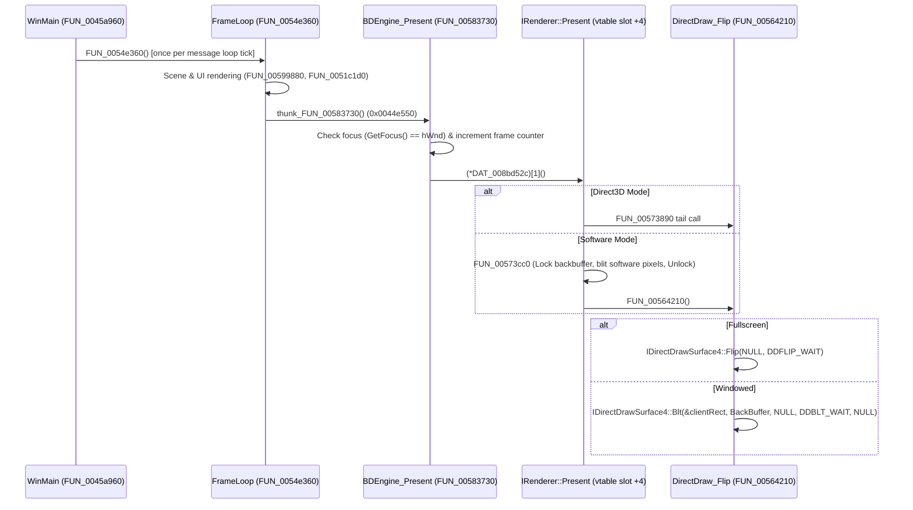

# Theme Park World: Resolution and Display Pipeline Reverse Engineering Report

## Executive Summary

Theme Park World (1999, Bullfrog / Electronic Arts) uses a dual-path display architecture built upon **DirectDraw 4** for display mode management and surface presentation, paired with either **Direct3D 3 (HAL)** for hardware acceleration or Bullfrog's proprietary software rasterizer (**BDEngine**).

Resolution configuration is driven by `Resolution.sam`, which maps integer indices (0–7) to standard screen modes from 512x384 up to 2048x1536 (defaulting to 640x480). Presentation uses a page-flipping mechanism in fullscreen mode and windowed blitting with an `IDirectDrawClipper` in windowed mode.

---

## 1. Resolution Selection Architecture

### 1.1 `Resolution.sam` Parsing and Configuration
- **File & Key**: The game loads `Resolution.sam` through the engine's generic `.sam` parser [`FUN_00401650`](ghidra-export/decompiled.c#L194013).
  - Parser function: [`FUN_004017a0`](ghidra-export/decompiled.c#L194140) (`SAM_ParseFile`).
  - Section header: `GameOptions` (string at `0x007449cc`).
  - Key name: `RESOLUTION` (string at `0x00744a80`).
  - Table entry descriptor at `0x00744a40` defines entry type `6` (integer property).
  - The parsed integer value is stored directly into global variable [`DAT_007858ec`](ghidra-export/decompiled.c#L20798).

### 1.2 Resolution Lookup Table ([`FUN_00449ec0`](ghidra-export/decompiled.c#L20755))
Resolution application occurs in [`FUN_00449ec0`](ghidra-export/decompiled.c#L20755) (`Display_ApplyResolutionSetting`). The function inspects [`DAT_007858ec`](ghidra-export/decompiled.c#L20798):

| `RESOLUTION` Value | Target Resolution | Width (`DAT_007a1968`) | Height (`DAT_007a1930`) | Confidence | Notes |
|---|---|---|---|---|---|
| **0** | Options / Custom | Dynamic | Dynamic | H | Reads [`DAT_0078d8dc`](ghidra-export/decompiled.c#L20815): `0` = 512x384, `2` = 800x600, else 640x480 |
| **1** | 512x384 | 512 (`0x200`) | 384 (`0x180`) | H | Low-resolution mode |
| **2** | 640x480 | 640 (`0x280`) | 480 (`0x1e0`) | H | Standard default mode |
| **3** | 800x600 | 800 (`0x320`) | 600 (`0x258`) | H | Standard medium mode |
| **4** | 1024x768 | 1024 (`0x400`) | 768 (`0x300`) | H | High-resolution mode |
| **5** | 1280x1024 | 1280 (`0x500`) | 1024 (`0x400`) | H | High-resolution 5:4 mode |
| **6** | 1600x1200 | 1600 (`0x640`) | 1200 (`0x4b0`) | H | Ultra-high mode |
| **7** | 2048x1536 | 2048 (`0x800`) | 1536 (`0x600`) | H | Maximum supported resolution |

After selecting width and height:
- `DAT_007a0c9c = (float)DAT_007a1968 * 0.5f` (screen half-width / center X).
- `DAT_007a162c = (float)DAT_007a1930 * 0.5f` (screen half-height / center Y).
- Calls [`FUN_0041a5a0`](ghidra-export/decompiled.c#L20890) to classify the width into UI scaling tiers:
  - Tier `0`: width $\le 512$
  - Tier `1`: width $\le 640$
  - Tier `2`: width $\le 800$
  - Tier `3`: width $> 800$

---

## 2. DirectDraw Initialization Pipeline

DirectDraw setup is implemented in [`FUN_00563460`](ghidra-export/decompiled.c#L195370) (`DirectDraw_InitDisplay`).

### 2.1 Device Enumeration and Creation
1. DirectDraw device enumeration is triggered via `DirectDrawEnumerateA` with callback [`FUN_005633e0`](ghidra-export/decompiled.c#L195340).
   - Up to 4 device GUIDs (16 bytes each) are recorded into `param_1 + 0x448`.
   - The device count is stored at `param_1[0x1e2]` (`+0x788`).
2. `DirectDrawCreate` is called:
   - For primary display: `DirectDrawCreate(NULL, param_1, NULL)`.
   - For secondary display: `DirectDrawCreate(&deviceGUID, param_1, NULL)`.
3. Upgrades interface pointers via `QueryInterface`:
   - `IID_IDirectDraw2` (`b3a6f3e0-2b43-11cf-a2de-00aa00b93356` at `0x007071f0`) $\rightarrow$ stored at `param_1[1]`.
   - `IID_IDirectDraw4` (`9c59509a-39bd-11d1-8c4a-00c04fd930c5` at `0x00707200`) $\rightarrow$ stored at `param_1[2]`.
4. Driver capabilities and identification are queried via `IDirectDraw4::GetDeviceIdentifier` and `IDirectDraw4::GetCaps`.

### 2.2 DirectDraw Surfaces & Topologies

```
Fullscreen Topology:
+-----------------------------------------------------------+
| IDirectDrawSurface4 Primary Surface (param_1[4])          |
| Caps: DDSCAPS_PRIMARYSURFACE | DDSCAPS_FLIP |             |
|       DDSCAPS_COMPLEX | DDSCAPS_3DDEVICE (0x4218)         |
| BackBufferCount: 1 (or 2 if triple buffering)             |
+-----------------------------------------------------------+
                             |
                   Attached Back Buffer
                             v
+-----------------------------------------------------------+
| IDirectDrawSurface4 Back Buffer Surface (param_1[5])      |
| Retrieved via GetAttachedSurface(DDSCAPS_BACKBUFFER)      |
+-----------------------------------------------------------+

Windowed Topology:
+-----------------------------------------------------------+
| IDirectDrawSurface4 Primary Surface (param_1[4])          |
| Caps: DDSCAPS_PRIMARYSURFACE (0x200)                      |
| Attached to IDirectDrawClipper (param_1[3]) bound to hWnd |
+-----------------------------------------------------------+
                             ^
                   Blt presentation
                             |
+-----------------------------------------------------------+
| IDirectDrawSurface4 Offscreen Plain Surface (param_1[5])  |
| Dimensions: DAT_007a1968 x DAT_007a1930                   |
| Caps: DDSCAPS_OFFSCREENPLAIN | DDSCAPS_3DDEVICE (0x6040)  |
+-----------------------------------------------------------+
```

---

## 3. Direct3D & Software Renderer Initialization

### 3.1 Direct3D Initialization ([`FUN_00572c40`](ghidra-export/decompiled.c#L205240) $\rightarrow$ [`FUN_00573080`](ghidra-export/decompiled.c#L205370))
- **Entry String**: `\n\n ***** Initializing Direct3D` (`0x007689b0`).
- **Success String**: `Direct3D initialized succesfully` (`0x007688ec`).
- **Setup Stages**:
  1. **Voodoo 1 Blacklist Check**: Inspects `VendorID == 0x121a` and `DeviceID == 0x0001`. If matched, HAL is aborted with message `\n*** Detected Voodoo1, failing HAL\n` (`0x007689d0`).
  2. **Query D3D Interface**: Queries `IID_IDirect3D3` (`bb223240-e72b-11d0-a9b4-00aa00c0993e` at `0x00707520`) on the DirectDraw object.
  3. **Z-Buffer Allocation**:
     - Enumerates supported Z-buffer pixel formats via `IDirect3D3::EnumZBufferFormats` with callback [`FUN_00573660`](ghidra-export/decompiled.c#L205660).
     - Allocates Z-buffer surface via `IDirectDraw4::CreateSurface` (`DDSCAPS_ZBUFFER | DDSCAPS_VIDEOMEMORY = 0x24000`) matching surface width and height (`DAT_008bcbd0` x `DAT_008bcbd4`).
     - Attaches the Z-buffer surface to the back buffer via `IDirectDrawSurface4::AddAttachedSurface`.
  4. **Device Creation**: Calls `IDirect3D3::CreateDevice` requesting `IID_IDirect3DHALDevice` (`84e63de0-46aa-11cf-816f-00aa006e1520`) bound to the back buffer surface (`DAT_00879a24 + 0x14`).
  5. **Texture Format Enumeration**: Enumerates supported texture formats via `IDirect3DDevice3::EnumTextureFormats` with callback [`FUN_00573060`](ghidra-export/decompiled.c#L205350).
  6. **Viewport Creation**: Creates viewport via `IDirect3D3::CreateViewport`, assigns `D3DVIEWPORT2` structure (`width`, `height`, `dvClipX`, `dvClipY`), adds and activates it via `SetCurrentViewport`.
  7. **Render States**: Sets initial states:
     - `D3DRENDERSTATE_ZENABLE = 1`
     - `D3DRENDERSTATE_ZFUNC = D3DCMP_LESSEQUAL (4)`
     - `D3DRENDERSTATE_ZWRITEENABLE = 1`

### 3.2 Software Renderer Path ([`FUN_00573960`](ghidra-export/decompiled.c#L205840) $\rightarrow$ [`FUN_00573b90`](ghidra-export/decompiled.c#L205930))
- **Entry String**: `\n\nInitializing Software renderer` (`0x00768a24`).
- **Success String**: `Software renderer initialized succesfully` (`0x007689f8`).
- **Buffer Allocation**: Allocates an internal 32-bit software color framebuffer of size `Width * Height * 4` bytes using [`FUN_00678e70`](ghidra-export/decompiled.c#L225430).
- Sets up rasterizer pitch (`DAT_008bcbd0 * 4`), 16-bit depth buffer stride (`DAT_008bcbd0 * 2`), and viewport bounds `(0, 0, Width - 1, Height - 1)`.

---

## 4. Renderer Selection Mechanism

1. **Active Renderer Global Variable**:
   - [`DAT_008bd524`](ghidra-export/decompiled.c#L195320):
     - `1` = Direct3D Hardware Acceleration
     - `4` = Bullfrog Software Renderer
2. **Options Determination ([`FUN_0044de20`](ghidra-export/decompiled.c#L20720))**:
   - Controlled by [`DAT_0078d8d8`](ghidra-export/decompiled.c#L20740) (3D Hardware Acceleration flag from Graphics Options / settings):
     - If `DAT_0078d8d8 == 0`: `DAT_008bd524 = 4` (software).
     - If `DAT_0078d8d8 != 0`: `DAT_008bd524 = 1` (Direct3D).
3. **Automatic Fallback ([`FUN_0044df20`](ghidra-export/decompiled.c#L20745))**:
   - `FUN_0044df20` tries to initialize Direct3D. If `DirectDraw_InitDisplay` or `Direct3D_Init` fails, it logs the error, switches `DAT_008bd524 = 4`, and re-runs display initialization using the software renderer.
4. **Diagnostic Strings**:
   - System information banner [`FUN_005835c0`](ghidra-export/decompiled.c#L206100):
     ```c
     FUN_0067a650(buf, "Renderer: %d", *(undefined4 *)(param_1 + 0x1c));
     ```
   - Error code mapper [`FUN_0056a770`](ghidra-export/decompiled.c#L196880) translates error codes:
     - `0xb0754009` (`-0x4f8abff7`): `"No rendering system?\n"` (`0x00766524`).
     - `0xb0754010` (`-0x4f8abff0`): `"Failed to init software renderer.\n"` (`0x0076647c`).

---

## 5. Display Mode Setting: Fullscreen vs Windowed

The decision and mode application take place in [`FUN_00563460`](ghidra-export/decompiled.c#L195370):

```
                        Fullscreen Mode (param_6 == 1)
                                      |
         +----------------------------+----------------------------+
         v                                                         v
IDirectDraw4::SetCooperativeLevel                         IDirectDraw4::SetDisplayMode
(hWnd, 0x851)                                             (Width, Height, BPP, 0, 0)
- DDSCL_EXCLUSIVE (0x01)                                  - Width: DAT_007a1968
- DDSCL_FULLSCREEN (0x10)                                 - Height: DAT_007a1930
- DDSCL_ALLOWREBOOT (0x40)                                - BPP: 16 (or 32 if 0x200000 flag set)
- DDSCL_NOWINDOWCHANGES (0x800)


                         Windowed Mode (param_6 == 0)
                                      |
         +----------------------------+----------------------------+
         v                                                         v
IDirectDraw4::SetCooperativeLevel                         Window Sizing & Clipping
(hWnd, 0x808)                                             - MoveWindow / SetWindowPos
- DDSCL_NORMAL (0x08)                                     - IDirectDraw4::CreateClipper
- DDSCL_NOWINDOWCHANGES (0x800)                           - Clipper->SetHWnd(0, hWnd)
(SetDisplayMode is NOT called)                            - PrimarySurface->SetClipper(Clipper)
```

Diagnostic strings printed during setup:
- Fullscreen: `"Fullscreen %d:%d:%d"` (`0x00766208`) passing width, height, and bit depth.
- Windowed: `"Windowed %d:%d:??"` (`0x007661f4`) passing width and height.

---

## 6. The Frame Rendering and Presentation Pipeline



---

## 7. Resolution Constants (640 / 480) Analysis

Exhaustive search of `640` (`0x280`) and `480` (`0x1e0`) identified the following key display-related sites:

1. [`FUN_00449ec0`](ghidra-export/decompiled.c#L20755) (`Display_ApplyResolutionSetting`):
   - `DAT_007a1968 = 0x280;` (width default = 640).
   - `DAT_007a1930 = 0x1e0;` (height default = 480).
2. [`FUN_00587a70`](ghidra-export/decompiled.c#L206330) (`UI_RenderLoadingBar`):
   - `(DAT_008bcbd0 * 0xe) / 0x280` (scales coordinate $X=14$ from reference 640 width to current screen width).
   - `(DAT_008bcbd4 * 0xb) / 0x1e0` (scales coordinate $Y=11$ from reference 480 height to current screen height).
   - `(DAT_008bcbd4 * 0x1be) / 0x1e0` (scales coordinate $Y=446$ from reference 480 height to current screen height).
3. [`FUN_0054df20`](ghidra-export/decompiled.c#L20745) & [`FUN_0054e070`](ghidra-export/decompiled.c#L20760):
   - `(uint)(DAT_007a1930 << 6) / 0x1e0` (scales 64px vertical UI element by $\text{Height} / 480$).
4. [`FUN_0051b010`](ghidra-export/decompiled.c#L194880) (`Video_PlayTGQFrame`):
   - `(uint)(DAT_007a1930 * 0x160) / 0x1e0` (scales 352px video height by $\text{Height} / 480$).
5. [`FUN_00476a90`](ghidra-export/decompiled.c#L21040):
   - `if (DAT_007a1968 == 0x280) { *puVar2 |= 0x80c8010; }` (enables specialized 640x480 UI rendering flag).
6. [`FUN_00579e00`](ghidra-export/decompiled.c#L205980):
   - `if (DAT_008bcbd0 != 0x280) ...` (camera/render frustum adjustment when not running in 640x480).
7. [`FUN_00587380`](ghidra-export/decompiled.c#L206250):
   - Tests whether screen width matches known low-resolution modes: `400`, `512` (`0x200`), or `640` (`0x280`).

---

## 8. Function Names Table

The following function names have been established from this investigation:

```tsv
address	name	note
00449df0	Config_InitDefaultDisplayOptions	Sets default display flags (0xc0e15) and checks dialog.tcf
00449ec0	Display_ApplyResolutionSetting	Reads RESOLUTION SAM key and maps 0-7 to width/height
0044dd50	Display_SelectRenderer_Debug	Debug renderer selection branch for dialog.tcf mode
0044de20	Display_SelectRenderer	Chooses between Direct3D (1) and Software (4) via DAT_0078d8d8
0044df20	Display_InitRendererWithFallback	Attempts Direct3D init; on failure falls back to Software renderer
0044e080	Display_CreateGameWindowAndInit	Registers window class, calls CreateWindowExA, initiates display setup
0044e550	thunk_BDEngine_Present	Thunk calling BDEngine_Present (0x00583730)
0045a960	Main_GameLoop	WinMain and primary message pump / game loop
0051b010	Video_PlayTGQFrame	Plays TGQ cutscene video frames and blits to DirectDraw surfaces
0054e360	Game_ProcessFrameTick	Per-frame update, world rendering, and buffer flip invocation
005632b0	DirectDraw_CreateContext	Allocates 0x790-byte DirectDraw context structure and invokes init
005633a0	DirectDraw_ReleaseContext	Releases DirectDraw context and all associated surfaces
005633e0	DirectDraw_EnumerateCallback	DirectDrawEnumerateA callback collecting device GUIDs
00563460	DirectDraw_InitDisplay	Configures fullscreen/windowed cooperative levels, SetDisplayMode, surfaces
005640a0	DirectDraw_ReleaseSurfaces	Releases primary surface, back buffer, clipper, and DDraw interfaces
00564210	DirectDraw_FlipBuffers	Executes IDirectDrawSurface4::Flip or Blt based on display mode
0056a770	DirectX_GetErrorMessage	Translates DirectDraw/Direct3D HRESULTs and engine error codes to strings
00572c40	Direct3D_CreateContext	Allocates 0x22c-byte Direct3D context and calls Direct3D_Init
00572d50	Direct3D_Shutdown	Releases Direct3D device, viewport, and Z-buffer
00573080	Direct3D_Init	Initializes IDirect3D3, Z-buffer surface, HAL device, viewport, render states
00573660	Direct3D_EnumZBufferCallback	IDirect3D3::EnumZBufferFormats callback selecting suitable depth buffer
00573890	Direct3D_PresentThunk	IRenderer vtable slot +4 thunk tail-calling DirectDraw_FlipBuffers
00573960	SoftwareRenderer_CreateContext	Allocates 0x18-byte Software Renderer context and initializes rasterizer
00573b30	SoftwareRenderer_Shutdown	Frees software renderer framebuffer memory and context
00573b90	SoftwareRenderer_Init	Allocates 32-bit framebuffer (Width*Height*4) and sets up rasterizer state
00573cc0	SoftwareRenderer_Present	Locks DirectDraw back buffer, copies software pixels, unlocks, and flips
00573ee0	SoftwareRenderer_PresentThunk	IRenderer vtable slot +4 thunk calling SoftwareRenderer_Present
00582eb0	BDEngine_SetDisplayMetrics	Stores width, height, aspect ratio, and half-extents in DAT_008bcbc8
005835c0	System_LogDiagnostics	Logs clock frequency, RAM, renderer ID, and build version
005836d0	BDEngine_InitSelectedRenderer	Calls Direct3D_CreateContext (1) or SoftwareRenderer_CreateContext (4)
00583700	BDEngine_ShutdownSelectedRenderer	Calls Direct3D_Shutdown (1) or SoftwareRenderer_Shutdown (4)
00583720	BDEngine_BeginScene	IRenderer vtable slot +0 (Clear / BeginScene)
00583730	BDEngine_Present	Presents current frame by calling IRenderer vtable slot +4 (Present)
```
