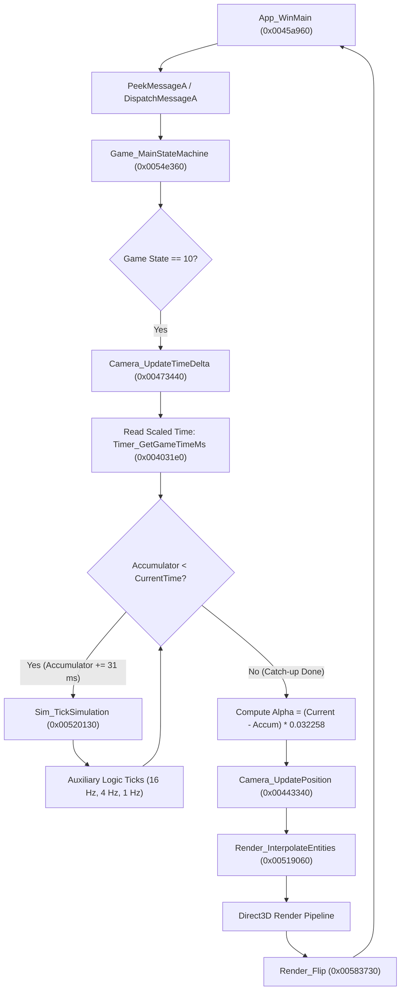
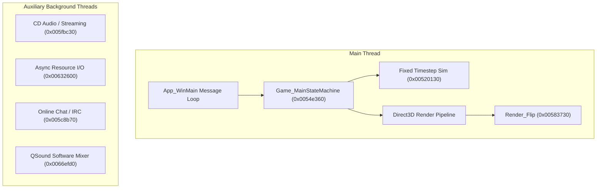

# Theme Park World (1999) — Game Loop & Frame Timing Analysis

**Target Executable:** `TP.exe` (Bullfrog Productions / Electronic Arts, 1999)  
**Image Base:** `0x00400000`  
**Toolchain:** MSVC 5.10 / 6.0 (Visual Studio 97/6.0, 32-bit x86)  

---

## 1. Executive Summary

Theme Park World's timing architecture uses a **hybrid fixed-timestep simulation coupled with an uncapped interpolated rendering loop**. The simulation logic updates in discrete 31 ms steps (~32.258 Hz), while visual entity positions are linearly interpolated between ticks using the fractional remainder of the tick duration.

In its original 1999 release environment, the game relied implicitly on DirectDraw hardware page-flipping (`IDirectDrawSurface::Flip`) blocking on vertical blank synchronization (VSync, 60 Hz or 70/75 Hz on CRT displays) to pace frames. On modern Windows (Windows 10/11) and modern graphics drivers:
1. DirectDraw surface presentation is emulated without VSync blocking, causing the main loop to execute unconstrained (hundreds to thousands of frames per second).
2. Several critical subsystems—most notably **camera panning/rotation** and **per-frame animation updates**—are executed once per render frame rather than within the fixed simulation tick or without proper delta-time scaling.
3. High frame rates cause the integer millisecond delta timer to collapse to 0 ms, and multi-core `QueryPerformanceCounter` jitter causes negative deltas that underflow unsigned 32-bit arithmetic into massive jumps.

---

## 2. Main Game Loop Architecture

### 2.1 Entry Point & WinMain Flow [Confidence: H]
- **CRT Entry Point:** `entry` at `0x0067ee10`. Prepares the C runtime environment, parses the command line, retrieves startup info, and invokes the WinMain function:
  - Address: `0x0045a960` (`App_WinMain`)
  - Signature: `int APIENTRY WinMain(HINSTANCE hInstance, HINSTANCE hPrevInstance, LPSTR lpCmdLine, int nCmdShow)`
- **Message Pump:** Lines `43206`–`43216` implement a non-blocking `PeekMessageA` message loop:
  - Calls `PeekMessageA(&msg, NULL, 0, 0, PM_NOREMOVE)`.
  - While messages are pending, calls `GetMessageA(&msg, NULL, 0, 0)`, `TranslateMessage(&msg)`, and `DispatchMessageA(&msg)`.
  - If `GetMessageA` receives `WM_QUIT`, the loop terminates and exits.

### 2.2 Idle / Per-Frame Step [Confidence: H]
When the Windows message queue is empty, `App_WinMain` executes the frame cycle:
1. `FUN_005b5bf0(DAT_00f7d88c)`: Updates network/online news monitoring.
2. `uVar5 = FUN_0054e360()`: Invokes `Game_MainStateMachine()`.
3. Bitwise-ORs the returned status `uVar5` into `DAT_007a1a14`. If bit 2 (`0x02`) is returned, the game loop exits.
4. Immediately loops back to `PeekMessageA` via `goto joined_r0x0045aafb`.

> [!IMPORTANT]
> `App_WinMain` contains **no Sleep, no timer wait, and no frame-limiting delay**. The loop spins as fast as the operating system and graphics driver allow.

---

## 3. Game State Machine & Simulation Loop (`0x0054e360`)

The primary engine state machine (`Game_MainStateMachine` at `0x0054e360`) governs engine transitions. The main park gameplay state is **Case 10** (`0x0A`).



### 3.1 Fixed Timestep Simulation [Confidence: H]
Within state 10 (lines `9004`–`9140`):
- `DAT_008786bc = thunk_FUN_004031e0()`: Obtains the current game time in milliseconds (adjusted by the speed multiplier).
- `DAT_00878c74`: The simulation accumulator (previous tick timestamp).
- Clamping spiral-of-death catch-up:
  ```c
  if (2000 < DAT_008786bc - DAT_00878c74) {
      DAT_00878c74 = DAT_008786bc - 2000;
  }
  ```
  The engine will simulate a maximum of 2,000 ms (~64 ticks) in a single frame before abandoning backlog.
- **Fixed Timestep Step:** Discrete step size is `0x1f` = **31 milliseconds** (~32.258 ticks/second).
- **Tick Counter:** `DAT_00877d34` increments by 1 each 31 ms step.
- **Tiered Simulation Execution:**
  - **Every 31 ms (Tick & 0, ~32 Hz):** Calls `Sim_TickSimulation` (`0x00520130`) to update park objects, visitor decisions, staff navigation, and ride mechanical timers. Followed by `FUN_00546c80` and `FUN_005516b0`.
  - **Every 62 ms (`Tick & 1 == 0`, ~16 Hz):** Calls `FUN_0055abf0` and `FUN_00475360`.
  - **Every 248 ms (`Tick & 7 == 0`, ~4 Hz):** Calls `FUN_00516380` and `FUN_0055a470`.
  - **Every 992 ms (`Tick & 0x1f == 0`, ~1 Hz):** Calls `FUN_004c81e0` and `FUN_004c8d30` (financial calculations, park ratings, visitor attraction counts).

### 3.2 Visual Interpolation [Confidence: H]
Following the `while (DAT_00878c74 < DAT_008786bc)` simulation loop, rendering runs:
- `local_564 = DAT_008786bc - DAT_00878c74`: Calculates the remaining time deficit (in milliseconds).
- **Interpolation Factor Calculation:**
  - `(float)(int)local_564 * 0.032258064`: Note that `0.032258064f` is exactly $\frac{1.0}{31.0}$.
  - `(float)(int)local_564 * 0.016129032`: $\frac{1.0}{62.0}$ (for 16 Hz entities).
  - `(float)(int)local_564 * 0.004032258`: $\frac{1.0}{248.0}$ (for 4 Hz entities).
- Calls `Render_InterpolateEntities` (`0x00519060`), which iterates active entities (`ThingList`) and invokes `Render_InterpolateThing` (`0x00546280`) with this fraction to blend positions/orientations.

---

## 4. `timeGetTime` Usage Catalog

The executable imports `timeGetTime` from `WINMM.DLL` (entry in IAT at `0x006fd3ec`). All 10 call sites across 8 functions have been identified:

| Address | Calling Function | Purpose | Confidence |
|---|---|---|---|
| `0x0055e591` | `FUN_0055e570` | **RDTSC CPU Calibration:** Base millisecond timer for calibrating processor frequency. | H |
| `0x0055e5b9` | `FUN_0055e570` | **RDTSC CPU Calibration:** Termination check of the RDTSC calibration loop. | H |
| `0x00586d80` | `0x00586d70` | **Splash Screen Shutdown:** Registered via `atexit`; enforces minimum 3,000 ms display time before process exit. | H |
| `0x00586d91` | `0x00586d70` | **Splash Screen Shutdown:** Busy-wait polling loop for splash screen timeout. | H |
| `0x005873bb` | `FUN_00587380` | **Splash Screen Init:** Verifies previous splash graphic has completed its 3,000 ms display window. | H |
| `0x0058797f` | `FUN_00587380` | **Splash Screen Init:** Enforces 2,500 ms display window for second splash image. | H |
| `0x005879d3` | `FUN_005879c0` | **Splash Screen Cleanup:** Enforces 3,000 ms hold prior to unloading splash texture buffers. | H |
| `0x00587c8f` | `FUN_00587c80` | **Splash / Progress Update:** Initial timestamp recording for loading screen progress bar. | H |
| `0x005f5e92` | `0x005f5e80` (`Platform_InitTimer`) | **Platform Timer Init:** Captures base timeGetTime baseline when initializing high-resolution timer. | H |
| `0x005f5f71` | `FUN_005f5f10` (`Platform_GetTimeMs`) | **Timer Fallback:** Used directly if `QueryPerformanceCounter` is unavailable or disabled. | H |
| `0x00659651` | `FUN_0065964a` | **Media/Movie Playback:** Tiny wrapper function invoked during TGQ video stream playback. | H |

---

## 5. Game Speed & Global Timer Architecture

### 5.1 Global Game Timer Object (`0x00785970`) [Confidence: H]
All game timekeeping is coordinated by a global timer instance at `DAT_00785970`:

| Offset | Type | Description |
|---|---|---|
| `+0x00` | `int` | Timer status flags / mode. |
| `+0x10` | `int` | Previous real-time millisecond sample (`iVar1`). |
| `+0x18` | `double` | Accumulated game time in scaled milliseconds. |
| `+0x20` | `double` | **Game Speed Multiplier** (Default `1.0`, initialized as `0x3ff0000000000000`). |
| `+0x28` | `int` | Frozen/pause sample time. |
| `+0x2c` | `int` | Pause duration offset. |
| `+0x30` | `int` | Pause active flag (1 = paused, 0 = running). |
| `+0x38` | `int` | Fixed-step recording mode flag (used during screenshot/video capture). |
| `+0x3c` | `int` | Fixed-step simulation accumulator. |
| `+0x40` | `int` | Fixed-step frame increment (default `31` ms / 32 FPS). |

### 5.2 Time Scaling Calculation (`0x004033a0`) [Confidence: H]
Every query to `Timer_GetGameTimeMs` (`0x004031e0`) triggers `Timer_UpdateAccumulatedTime` (`0x004033a0`):
```c
iVar2 = Platform_GetGameTimeMs(); // Monotonic ms clock (QPC / timeGetTime)
iVar1 = timer->lastRealTime;
timer->lastRealTime = iVar2;

delta = (uint)(iVar2 - iVar1);
timer->accumulatedScaledTime += ((double)delta * timer->speedMultiplier);
return (int)timer->accumulatedScaledTime;
```
- `Timer_GetSpeedMultiplier` (`0x00403390`) returns `timer->speedMultiplier` as a float.
- Accelerated gameplay in simulation functions (e.g. `FUN_0053c3f0`) scales particle and ride updates using this multiplier.

---

## 6. Root Cause: Why Theme Park World Runs Too Fast Above 60 FPS

The "unplayable above 60 FPS" behavior is caused by three distinct architectural flaws:

### 1. Loss of Hardware VSync Blocking in DirectDraw [Confidence: L — lead agent review 2026-10-13]

> Review note: nothing in the binary shows this; it is a claim about modern drivers. Full-screen `Flip(DDFLIP_WAIT)` normally still waits for vblank on Windows 10, so the game would run at the monitor's refresh rate. That fits PCGamingWiki's "unplayable above 60 FPS" (high-refresh monitors) better than "uncapped". Measure the frame rate in play before relying on it. Points 2 and 3 (camera and animation stepped per frame) remain the likely cause of the speed-up.

In 1999, `Render_Flip` (`0x00583730`) invoked `IDirectDrawSurface::Flip(NULL, DDFLIP_WAIT)`. In fullscreen DirectDraw mode on CRT monitors, this call blocked execution until the vertical blanking interval occurred (typically 60 Hz = 16.6 ms). The game loop relied on this hardware wait for frame pacing.  
On modern Windows 10/11 WDDM drivers, DirectDraw emulation does not block on VSync. Frames render and present instantly, allowing the main loop to spin at hundreds of iterations per second.

### 2. Camera Controls Are Frame-Locked, Not Delta-Timed [Confidence: H]
While park logic (`0x00520130`) runs inside the 31 ms fixed-timestep loop, **camera manipulation** is not:
- Camera updates in `Camera_UpdatePosition` (`0x00443340`) and `0x00435a30` run **once per render frame** directly in the presentation block.
- Camera rotation and linear movement do **not** multiply input by `DAT_007b497c` (delta time). They apply fixed position offsets directly per frame.
- At 144 FPS, camera pan and rotation are **2.4× faster** than intended; at 300 FPS, they are **5× faster**, making navigation practically unusable.

### 3. Delta-Time Truncation & Sub-Millisecond Collapse [Confidence: H]
In `Camera_UpdateTimeDelta` (`0x00473440`):
```c
DAT_007b497c = (float)(uint)(DAT_007b496c - prev_time) * 0.001f;
```
`DAT_007b496c` is an integer millisecond timestamp. When the game runs above 1,000 FPS (or during rapid back-to-back frames where 0 ms elapsed between calls), `(DAT_007b496c - prev_time)` equals `0`, resulting in `DAT_007b497c = 0.0f`. Any subsystem that relies on `DAT_007b497c` (such as model animations in `0x0044e410`) freezes or experiences severe stuttering.

### 4. Multi-Core QPC Inconsistency [Confidence: M]
In `Timer_UpdateAccumulatedTime` (`0x004033a0`), the delta is computed as `(uint)(iVar2 - iVar1)`. On multi-core modern CPUs without thread affinity, `QueryPerformanceCounter` can return timestamps that are non-synchronized across physical cores. If the thread migrates cores and reads a counter that is even 1 count earlier, `iVar2 - iVar1` produces a negative number that casts to `4,294,967,295` ms. While the game limits catch-up to 2,000 ms (`0x0054e360` line `9006`), this still causes sudden maximum-speed acceleration bursts.

---

## 7. Timer Resolution (`timeBeginPeriod`)

- **Analysis:** Neither `timeBeginPeriod` nor `timeEndPeriod` is imported or called anywhere in `TP.exe` [Confidence: H].
- **Consequence:** Under Windows NT/2000/XP/10/11, standard `timeGetTime` resolution defaults to the system timer interrupt rate (typically 15.6 ms or 10 ms). The game circumvents this by using `QueryPerformanceCounter` in `Platform_GetTimeMs` (`0x005f5f10`), but when falling back to `timeGetTime`, timing precision degrades significantly.

---

## 8. Threading Model

Theme Park World is **architecturally single-threaded for all game simulation and rendering** [Confidence: H].



The CRT thread creation functions `_beginthread` (`0x0067e050`) and `_beginthreadex` (`0x0067f780`) are called only for four background helper tasks:
1. **CD Audio Streamer** (`0x005fbc30`): Background worker thread (`0x005fba00`) for streaming redbook/track audio.
2. **Asynchronous File / Resource I/O** (`0x00632600`): Background worker thread (`0x00632460`) for loading game archive packages.
3. **Network / IRC Chat Client** (`0x005c8b70` / `0x005d1ac0`): Background socket worker thread (`0x005d2850`) for in-game chat services.
4. **QSound Software Mixer** (`0x0066efd0`): Internal audio buffer feeder thread for QSound/QMixer.

---

## 9. Profiling, FPS Counters & `enginedebug.txt`

### 9.1 `enginedebug.txt` Diagnostic Logging [Confidence: H]
- **Implementation:** `EngineDebug_Log` at `0x00564650`.
- **Behavior:**
  - On first call (`DAT_00879a2c == 0`), opens `enginedebug.txt` with `"w"` (write mode).
  - On subsequent calls, opens `enginedebug.txt` with `"a"` (append mode).
  - Formats output via `fwprintf`/`fprintf`, flushes the buffer (`0x0067d070`), and immediately closes the file (`0x0067b620`).
- **Trigger:** Over **45 call sites** across Direct3D, DirectDraw, and texture loaders invoke this function upon encountering errors (e.g. `s_Procedural_textures_not_allowed..._0076831f`, unsupported display bit depths, surface allocation errors, or failed texture loads). It is **not** gated by a command-line argument; it writes whenever a graphics failure occurs.

### 9.2 Built-In FPS Counter [Confidence: H for the counter; toggle corrected]

> Correction 2026-10-13 (`re/startup-and-switches.md`): `0x0046c0b0` is a CRT static initialiser and `0x00729f00` the static-constructor table, not a hotkey table. Nothing ever sets `0x007b05d0`; turning the counter on needs a patch. The `E: W: R: P: S:` profiler line in 9.3 goes to an empty trace stub and is never shown.

- **Toggle Variable:** `DAT_007b05d0` (1 = display active, 0 = disabled).
- **Calculation:** In `Game_MainStateMachine` (`0x0054e360`, lines `183696`–`183702`):
  ```c
  frame_ms = Timer_GetGameTimeMs() - DAT_00875034;
  if (DAT_007b05d0 != 0) {
      Debug_RenderFps(1000.0f / (float)frame_ms);
  }
  ```
- **Rendering:** `Debug_RenderFps` (`0x0046c0d0`) formats string `FPS: %.4g` (`s_FPS___4g_0074d85c`) and prints it via engine font renderer `0x0057cb10`.
- **Toggle Handler:** Triggered via developer hotkey handler `0x0046c0b0` registered in keybind table `0x00729f00`.

### 9.3 Engine Performance Profiler [Confidence: H]
In State 10 (lines `9235`–`9244`), the engine calculates rolling 8-frame averages for five core systems and formats:
```
E: %d  W: %d  R: %d  P: %d  S: %d
```
Representing millisecond execution times for:
- `E` = Engine overhead
- `W` = World / Park simulation
- `R` = Rendering
- `P` = Peeps (visitors/staff AI)
- `S` = Sound

---

## 10. Frame Rate Limiting Strategy for Modern Compatibility

To fix the speed issues on modern systems, frame rate throttling must be enforced:

1. **Target Framerate:** **60 FPS** (frame time target = `16.666 ms`).
2. **Optimal Hook Location:** Inside `Render_Flip` (`0x00583730`) or at the end of each `App_WinMain` (`0x0045a960`) iteration.
3. **Implementation Model:**
   ```c
   static DWORD s_lastFrameTime = 0;
   DWORD now = timeGetTime();
   DWORD elapsed = now - s_lastFrameTime;
   if (elapsed < 16) {
       Sleep(16 - elapsed);
   }
   s_lastFrameTime = timeGetTime();
   ```
4. **Resolution Requirement:** Must call `timeBeginPeriod(1)` at process initialization to enable 1 ms sleep precision.
5. **Thread Affinity:** Lock the main thread to a single CPU core via `SetThreadAffinityMask(GetCurrentThread(), 1)` to eliminate multi-core QPC clock skew.

---

## 11. Established Function Names

The following function names and roles have been identified from disassembly and decompiler analysis:

| Address | Name | Note |
|---|---|---|
| `00402d70` | `Timer_GetGlobalGameTime` | Global timer thunk to `Timer_GetGameTimeMs` using `DAT_00785970` |
| `004031e0` | `Timer_GetGameTimeMs` | Retrieves accumulated scaled game time in milliseconds |
| `004032b0` | `Timer_Construct` | Initializes timer struct; sets speed multiplier to 1.0 (`0x3ff00000`) |
| `00403390` | `Timer_GetSpeedMultiplier` | Returns the current game speed multiplier as float |
| `004033a0` | `Timer_UpdateAccumulatedTime` | Accumulates scaled millisecond delta using game speed multiplier |
| `00443340` | `Camera_UpdatePosition` | Per-frame camera position/angle update (unscaled by delta-time) |
| `0044e410` | `Animation_UpdateModels` | Updates model animation states using delta-time (`DAT_007b497c`) |
| `0045a960` | `App_WinMain` | WinMain entry point; manages PeekMessage message pump |
| `0046b600` | `App_WndProc` | Main window procedure (WM_ACTIVATE, WM_KEYDOWN, WM_MOUSEMOVE) |
| `0046c0b0` | `Debug_ToggleFpsCounter` | Debug hotkey handler toggling `DAT_007b05d0` (FPS counter) |
| `0046c0d0` | `Debug_RenderFps` | Formats and draws `FPS: %.4g` overlay |
| `00473440` | `Camera_UpdateTimeDelta` | Computes per-frame delta time (`DAT_007b497c`) in seconds |
| `00519060` | `Render_InterpolateEntities` | Distributes sub-tick interpolation fraction to all active entities |
| `00520130` | `Sim_TickSimulation` | Core park simulation tick (31 ms / ~32 Hz fixed timestep) |
| `0054e360` | `Game_MainStateMachine` | Main engine state machine; State 10 contains core gameplay loop |
| `0055e570` | `Sys_CalibrateRdtsc` | Calibrates CPU RDTSC cycles against `timeGetTime` |
| `00564650` | `EngineDebug_Log` | Diagnostic logger writing graphics errors to `enginedebug.txt` |
| `00583730` | `Render_Flip` | Presents backbuffer via DirectDraw Flip; increments `DAT_008bcc40` |
| `00586d70` | `Splash_AtexitCleanup` | Cleanup routine registered via atexit; enforces 3,000 ms splash delay |
| `00587380` | `Splash_Display` | Splash screen initialization and delay management |
| `005879c0` | `Splash_Free` | Splash screen texture deallocation (waits for 3,000 ms display window) |
| `00587c80` | `Splash_UpdateProgress` | Splash and loading progress bar update function |
| `005c8b70` | `Sys_CreateWorkerThread` | Operating system abstraction wrapping CRT `_beginthread` |
| `005f5e80` | `Platform_InitTimer` | Initializes high-resolution QPC counter and base `timeGetTime` |
| `005f5f10` | `Platform_GetTimeMs` | Low-level monotonic millisecond clock (QPC with `timeGetTime` fallback) |
| `005f5fa0` | `Platform_GetGameTimeMs` | Wrapper returning millisecond timestamp from global timer `DAT_00fa71e0` |
| `005fbc30` | `Audio_StartStreamingThread` | Creates worker thread for background CD / streaming audio |
| `00632600` | `IO_StartAsyncLoaderThread` | Creates worker thread for asynchronous file and package streaming |
| `0065964a` | `Media_GetTimeMs` | Wrapper for `timeGetTime` used during video stream synchronization |
| `0067e050` | `CRT_beginthread` | MSVC CRT thread creation implementation |
| `0067f780` | `CRT_beginthreadex` | MSVC CRT extended thread creation implementation |
| `0067ee10` | `CRT_WinMainCRTStartup` | PE entry point initializing MSVC CRT before calling `WinMain` |
